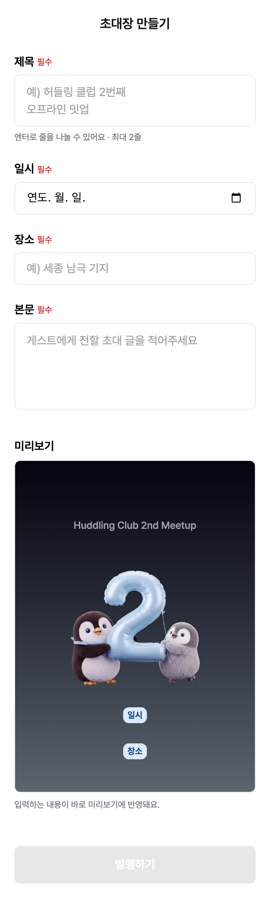
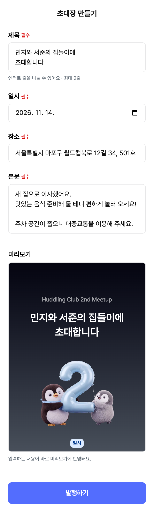
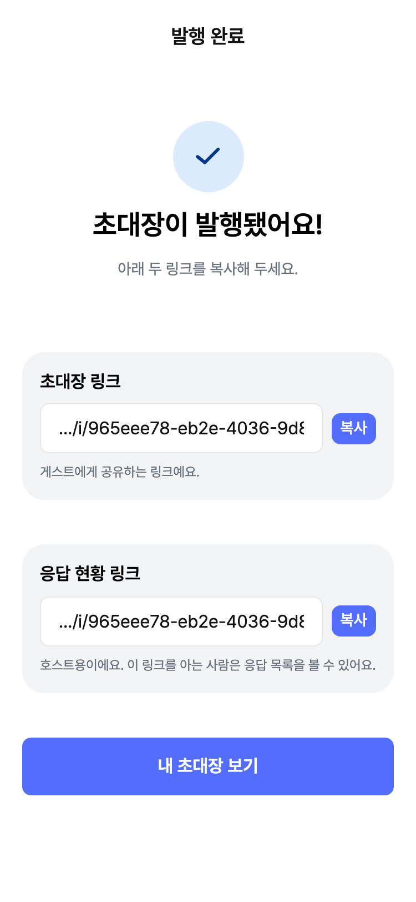
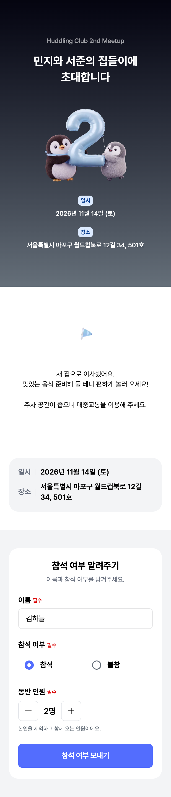
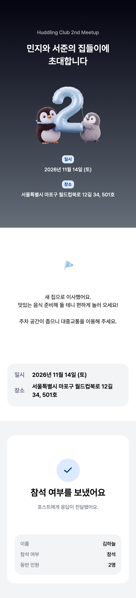
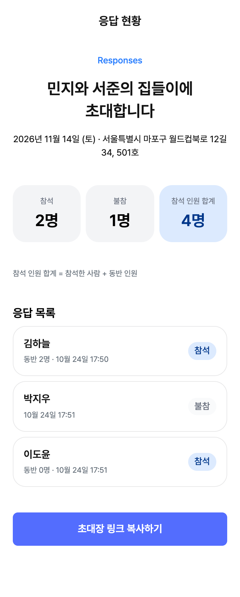
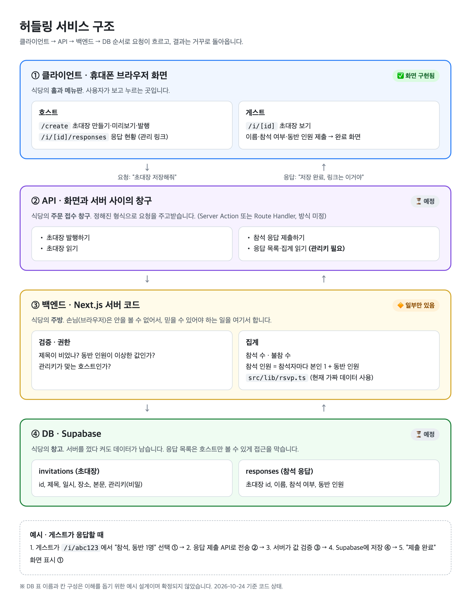

# Huddling

정보를 입력하면 모바일 웹 초대장을 만들고, 링크로 공유해 참석 응답을 받는 서비스입니다.
호스트와 게스트 모두 로그인 없이 링크로 사용합니다.

**서비스 주소:** https://online-invitation-six.vercel.app/

## 화면 구성

| 경로 | 사용자 | 기능 |
| --- | --- | --- |
| `/` | - | `/create`로 이동 |
| `/create` | 호스트 | 제목·일시·장소·본문 입력, 실시간 미리보기, 발행, 링크 복사 |
| `/i/[id]` | 게스트 | 초대장 보기, 이름·참석 여부·동반 인원 제출 |
| `/i/[id]/responses` | 호스트 | 응답 목록, 참석·불참 수, 참석 인원 합계 |

### 호스트: 초대장 만들기 → 발행

| 1. 만들기 (`/create`) | 2. 입력과 미리보기 | 3. 발행 완료 |
| :---: | :---: | :---: |
|  |  |  |

### 게스트: 초대장 보기 → 응답

| 4. 초대장과 응답 입력 (`/i/[id]`) | 5. 응답 완료 |
| :---: | :---: |
|  |  |

### 호스트: 응답 확인

| 6. 응답 현황 (`/i/[id]/responses`) |
| :---: |
|  |

- 참석 인원 합계는 참석 응답마다 `본인 1명 + 동반 인원`을 더합니다. 위 예시는 김하늘(1+2) + 이도윤(1+0) = 4명입니다.
- 스크린샷은 실제 사이트에 만든 예시 초대장으로 캡처했습니다. 이름은 모두 가짜입니다.

## 서비스 구조



- 화면: Next.js App Router (Server Component 기본, 입력·버튼이 있는 부분만 Client Component)
- 저장: 서버 액션(`src/lib/actions.ts`)이 입력을 검사한 뒤 Supabase에 저장
- 읽기: 페이지가 서버에서 Supabase 데이터를 읽어 화면을 만듦 (`src/lib/data.ts`)
- 배포: GitHub `main`에 push하면 Vercel이 자동으로 빌드·배포

## 실행

Node.js 20.9 이상과 npm이 필요합니다.

1. `.env.example`을 복사해 `.env.local`을 만들고 Supabase 값을 채웁니다.

   ```
   NEXT_PUBLIC_SUPABASE_URL=
   NEXT_PUBLIC_SUPABASE_PUBLISHABLE_KEY=
   ```

2. 설치 후 개발 서버를 실행합니다.

   ```bash
   npm ci
   npm run dev
   ```

3. 브라우저에서 http://localhost:3000 을 엽니다.

Vercel에서는 같은 변수를 **Settings → Environment Variables**에 넣습니다.

## 검증

```bash
npm run lint
npm run typecheck
npm run build
```

프로덕션 서버는 빌드 후 `npm start`로 실행합니다.

## 폴더 구조

- `src/app/create/`: 초대장 만들기 화면
- `src/app/i/[id]/`: 게스트 초대장 화면
- `src/app/i/[id]/responses/`: 응답 현황 화면
- `src/components/`: 여러 화면에서 쓰는 UI 컴포넌트
- `src/lib/supabase.ts`: Supabase 연결
- `src/lib/data.ts`: 초대장·응답 읽기
- `src/lib/actions.ts`: 초대장·응답 저장 (서버 검증 포함)
- `src/lib/rsvp.ts`: 응답 집계
- `src/lib/format.ts`: 날짜 표시
- `src/app/globals.css`: 전역 스타일과 Tailwind CSS v4 디자인 토큰
- `docs/`: PRD, 구조도, 스크린샷

`@/*` 경로 별칭은 `src/*`를 가리킵니다.

## 알려진 제한

- 응답 현황(`/i/[id]/responses`)은 아직 접근 제한이 없습니다. 실제 운영 전에 호스트 관리 링크 검증을 추가해야 합니다.
